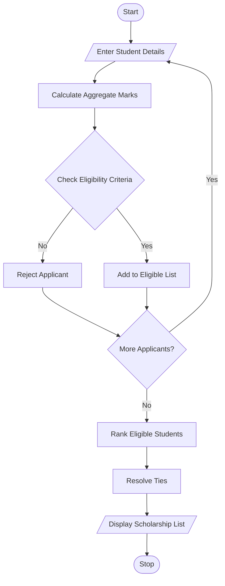

## 1. Problem Statement

Develop a Python program to evaluate students for university scholarships based on aggregate marks, subject-wise minimum marks, attendance percentage, and family income.

The program should:

- Accept student details.
- Check eligibility based on scholarship criteria.
- Rank eligible students according to aggregate marks.
- Resolve ties using attendance percentage and then lower family income.
- Display the final scholarship selection list.

## 2. Algorithm

1. Start the program.
2. Enter the number of applicants.
3. Enter each student's name and marks.
4. Enter subject-wise marks, attendance, and family income.
5. Calculate aggregate marks.
6. Check eligibility:
   - Aggregate marks must be at least 75%.
   - Each subject mark must be at least 60%.
   - Attendance must be at least 75%.
   - Family income must not exceed ₹2,50,000.
7. Add eligible students to the selection list.
8. Sort eligible students using:
   - Highest aggregate marks first.
   - Highest attendance if marks are equal.
   - Lowest family income if both are equal.
9. Display the ranked scholarship list.
10. Stop the program.

## 3. Flowchart 

## 5. Sample Input

Enter number of applicants: 3

Student 1
Enter student name: Rahul
Enter subject 1 marks: 85
Enter subject 2 marks: 90
Enter subject 3 marks: 80
Enter attendance percentage: 90
Enter family annual income: 200000

Student 2
Enter student name: Priya
Enter subject 1 marks: 90
Enter subject 2 marks: 90
Enter subject 3 marks: 90
Enter attendance percentage: 95
Enter family annual income: 180000

Student 3
Enter student name: Arjun
Enter subject 1 marks: 70
Enter subject 2 marks: 65
Enter subject 3 marks: 75
Enter attendance percentage: 80
Enter family annual income: 220000

## 6. Sample Output

Eligible for Scholarship
Eligible for Scholarship
Eligible for Scholarship

===== SCHOLARSHIP SELECTION LIST =====

Rank: 1
Name: Priya
Aggregate: 90.0 %
Attendance: 95.0 %
Family Income: Rs. 180000.0

Rank: 2
Name: Rahul
Aggregate: 85.0 %
Attendance: 90.0 %
Family Income: Rs. 200000.0

Rank: 3
Name: Arjun
Aggregate: 70.0 %
Attendance: 80.0 %
Family Income: Rs. 220000.0

Total Eligible Students: 20

Note: The scholarship eligibility criteria are assumed for this educational program. In the sample, Arjun is actually not eligible because his aggregate is 70%, below the required 75%. Therefore, the correct selection list contains only Priya and Rahul.
