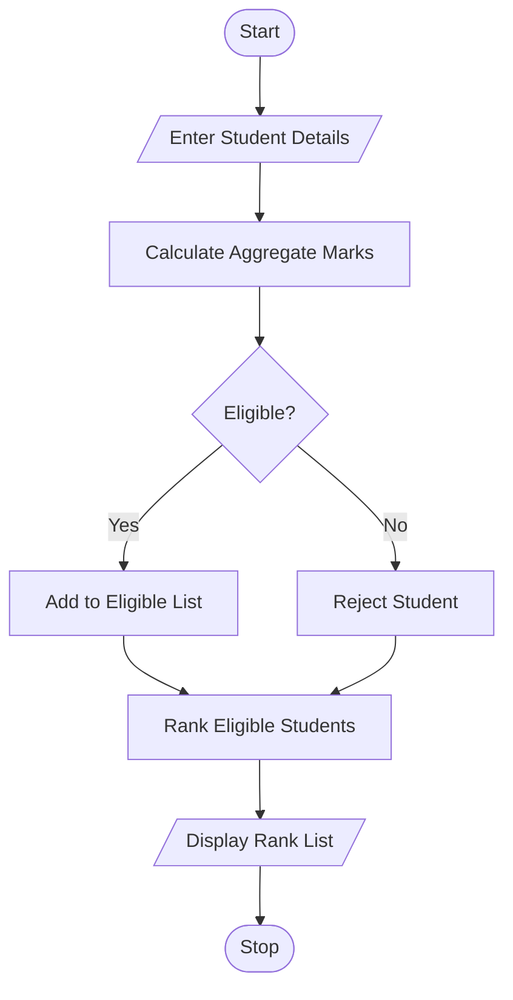

# University Scholarship Allocation – Python Program

## 1. Problem Statement

Develop a Python program to select eligible students for university scholarships based on aggregate marks, subject-wise minimum marks, attendance percentage, and family income. Rank eligible students according to aggregate marks. If students have equal marks, use attendance and family income to break the tie.

## 2. Algorithm

1. Start the program.
2. Enter the number of students.
3. Enter each student's name, three subject marks, attendance, and family income.
4. Calculate aggregate percentage.
5. Check eligibility:
   - Aggregate marks must be at least 75%.
   - Each subject mark must be at least 60%.
   - Attendance must be at least 75%.
   - Family income must not exceed ₹2,50,000.
6. Store eligible students.
7. Rank students using:
   - Highest aggregate marks first.
   - Highest attendance next.
   - Lowest family income next.
8. Display the eligible students and their ranks.
9. Stop the program.

## 3. Flowchart 

## 5. Sample Input

```
Enter number of students: 3

Student 1
Enter student name: Arjun
Enter subject 1 marks: 85
Enter subject 2 marks: 80
Enter subject 3 marks: 90
Enter attendance percentage: 90
Enter family income: 200000

Student 2
Enter student name: Ravi
Enter subject 1 marks: 90
Enter subject 2 marks: 85
Enter subject 3 marks: 95
Enter attendance percentage: 95
Enter family income: 180000

Student 3
Enter student name: Sita
Enter subject 1 marks: 70
Enter subject 2 marks: 65
Enter subject 3 marks: 75
Enter attendance percentage: 80
Enter family income: 150000
```

## 6. Sample Output

Eligible for Scholarship

Eligible for Scholarship

Not Eligible

----- SCHOLARSHIP RANK LIST -----

Rank: 1
Name: Ravi
Aggregate: 90.0 %
Attendance: 95.0 %
Family Income: Rs. 180000.0

Rank: 2
Name: Arjun
Aggregate: 85.0 %
Attendance: 90.0 %
Family Income: Rs. 200000.0


The Python program successfully checks scholarship eligibility, calculates aggregate marks, and ranks eligible students using marks, attendance, and family income as tie-breaking rules.
