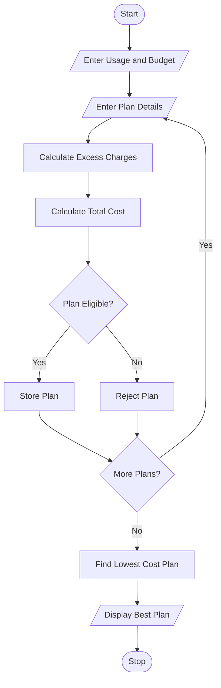

## 1. Problem Statement

Develop a Python program to compare multiple mobile recharge plans based on data usage, call minutes, validity, and budget. Calculate excess usage charges, check plan eligibility, and identify the most economical eligible mobile plan.

## 2. Algorithm

1. Start the program.
2. Enter required data usage, call minutes, validity, and budget.
3. Enter the number of mobile plans.
4. Enter each plan's price, data limit, call limit, and validity.
5. Calculate excess data and calling charges.
6. Calculate the total plan cost.
7. Check usage, validity, and budget conditions.
8. Store eligible plans.
9. Find the plan with the lowest total cost.
10. Display the best mobile plan.
11. Stop the program.

## 3. Flowchart 

## 5. Sample Input
Enter required data in GB: 2
Enter required call minutes: 500
Enter required validity days: 28
Enter your budget: 300
Enter number of plans: 3

Plan 1
Enter plan name: Basic
Enter plan price: 199
Enter data limit in GB: 1.5
Enter call limit in minutes: 400
Enter validity days: 28
Extra data charge per GB: 20
Extra call charge per minute: 0.5

Plan 2
Enter plan name: Smart
Enter plan price: 249
Enter data limit in GB: 2.5
Enter call limit in minutes: 600
Enter validity days: 28
Extra data charge per GB: 20
Extra call charge per minute: 0.5

Plan 3
Enter plan name: Premium
Enter plan price: 299
Enter data limit in GB: 3
Enter call limit in minutes: 700
Enter validity days: 56
Extra data charge per GB: 15
Extra call charge per minute: 0.5

## 6. Sample Output

```
Total Cost: Rs. 329.0
Not Eligible

Total Cost: Rs. 249.0
Eligible Plan

Total Cost: Rs. 299.0
Eligible Plan

----- PLAN COMPARISON -----

Smart - Rs. 249.0
Premium - Rs. 299.0

----- BEST MOBILE PLAN -----

Plan Name: Smart
Total Cost: Rs. 249.0
Validity: 28 days
Most Economical Plan
