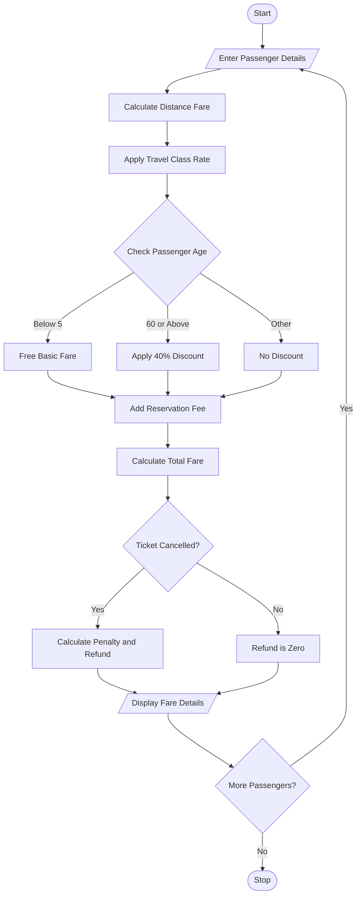

## 1. Problem Statement

Develop a Python program to calculate railway ticket fares for multiple passengers. The program should calculate fares based on travel distance, travel class, age-based concessions, reservation fees, and cancellation penalties. Finally, display the total ticket amount and cancellation refund for each passenger.

## 2. Algorithm

1. Start the program.
2. Enter the number of passengers.
3. Enter each passenger's name, age, distance, and travel class.
4. Calculate the basic fare based on distance.
5. Calculate the fare according to travel class.
6. Apply age-based concessions:
   - Children below 5 years: Free.
   - Senior citizens aged 60 and above: 40% concession.
7. Add the reservation fee.
8. Calculate the final ticket fare.
9. Enter whether the ticket is cancelled.
10. If cancelled, calculate the cancellation penalty and refund.
11. Display passenger-wise fare details.
12. Stop the program.

## 3. Flowchart 

## 5. Sample Input

Enter number of passengers: 2

Passenger 1
Enter passenger name: Ravi
Enter age: 25
Enter travel distance in km: 200
Select travel class: 1
Cancel ticket? (yes/no): no

Passenger 2
Enter passenger name: Sita
Enter age: 65
Enter travel distance in km: 200
Select travel class: 2
Cancel ticket? (yes/no): yes

## 6. Sample Output

----- TICKET DETAILS -----
Passenger: Ravi
Class: Sleeper
Basic Fare: 250.0
Reservation Fee: 40
Total Fare: 290.0
Cancellation Penalty: 0
Refund Amount: 0

----- TICKET DETAILS -----
Passenger: Sita
Class: AC 3 Tier
Basic Fare: 500.0
Reservation Fee: 40
Total Fare: 540.0
Cancellation Penalty: 108.0
Refund Amount: 432.0

----- FINAL SUMMARY -----
Total Ticket Amount: Rs. 830.0
Total Refund Amount: Rs. 432.0
