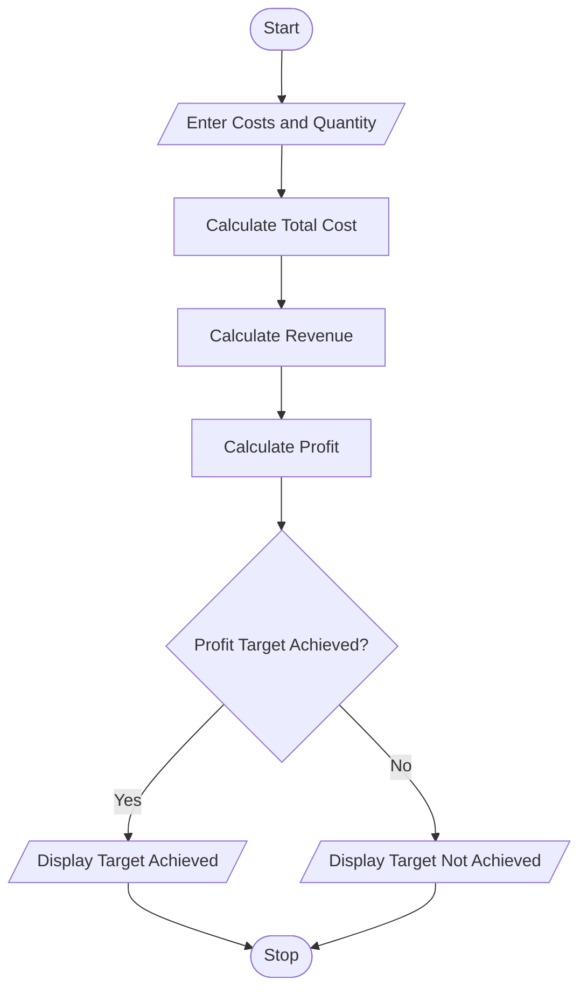

# Manufacturing Cost and Profitability Analysis – Python Program

## 1. Problem Statement

Develop a Python program to calculate the total manufacturing cost of a product by considering material costs, labour charges, wastage costs, and machine costs. Calculate the selling price, total profit, and profit percentage. Finally, check whether the production meets the specified profit target.

## 2. Algorithm

1. Start the program.
2. Enter the product name and production quantity.
3. Enter the material cost per unit.
4. Enter labour cost per unit.
5. Enter wastage percentage.
6. Enter machine cost per unit.
7. Calculate total material cost.
8. Calculate wastage cost.
9. Calculate total labour cost and machine cost.
10. Calculate the total manufacturing cost.
11. Enter selling price per unit.
12. Calculate total revenue and profit.
13. Calculate profit percentage.
14. Compare profit percentage with the target.
15. Display the manufacturing cost and profitability result.
16. Stop the program.

## 3. Flowchart 

## 5. Sample Input
Enter product name: Plastic Bottles
Enter production quantity: 1000
Enter material cost per unit: 20
Enter labour cost per unit: 5
Enter wastage percentage: 10
Enter machine cost per unit: 3
Enter selling price per unit: 40
Enter target profit percentage: 20

## 6. Sample Output
----- MANUFACTURING REPORT -----
Product Name: Plastic Bottles
Production Quantity: 1000

Material Cost: Rs. 20000.0
Wastage Cost: Rs. 2000.0
Labour Cost: Rs. 5000.0
Machine Cost: Rs. 3000.0

Total Manufacturing Cost: Rs. 30000.0
Total Revenue: Rs. 40000.0
Total Profit: Rs. 10000.0
Profit Percentage: 33.33 %

Result: Profit Target Achieved

The Python program successfully calculates manufacturing costs, wastage, labour charges, machine costs, total revenue, and profit. It also checks whether the production meets the specified profit target.
