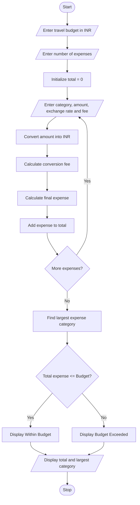

# 9. Multi-Currency Travel Budget Analysis – Python Program

## 1. Problem Statement

Develop a Python program to calculate travel expenses in different currencies using the given exchange rates. The program should:

- Accept travel expenses in different currencies.
- Convert expenses into Indian Rupees (INR).
- Include currency conversion fees.
- Calculate the total travel expenditure.
- Compare total expenditure with the planned budget.
- Identify the largest expense category.
- Display whether the travel budget is within or above the budget limit.

## 2. Algorithm

1. Start the program.
2. Read the travel budget in INR.
3. Read the number of expense categories.
4. For each category, enter:
   - Expense category name.
   - Expense amount.
   - Currency exchange rate.
   - Conversion fee percentage.
5. Convert the expense into INR using the exchange rate.
6. Calculate the conversion fee.
7. Add the conversion fee to the converted amount.
8. Calculate the total travel expenditure.
9. Identify the largest expense category.
10. Compare total expenditure with the planned budget.
11. Display total expenses, conversion fees, budget status, and largest expense category.
12. Stop the program.

## 3. Flowchart

## 5. Sample Input

Enter your travel budget in INR: 100000
Enter number of expense categories: 3

Expense 1
Enter expense category: Hotel
Enter expense amount: 300
Enter exchange rate to INR: 85
Enter conversion fee percentage: 2

Expense 2
Enter expense category: Food
Enter expense amount: 200
Enter exchange rate to INR: 85
Enter conversion fee percentage: 2

Expense 3
Enter expense category: Shopping
Enter expense amount: 500
Enter exchange rate to INR: 85
Enter conversion fee percentage: 2

## 6. Sample Output

Converted Amount: Rs. 25500.0
Conversion Fee: Rs. 510.0
Final Expense: Rs. 26010.0

Converted Amount: Rs. 17000.0
Conversion Fee: Rs. 340.0
Final Expense: Rs. 17340.0

Converted Amount: Rs. 42500.0
Conversion Fee: Rs. 850.0
Final Expense: Rs. 43350.0

----- TRAVEL BUDGET REPORT -----

Total Travel Expense: Rs. 86700.0
Total Conversion Fees: Rs. 1700.0
Largest Expense Category: Shopping
Largest Expense: Rs. 43350.0

Status: Within Budget
Remaining Budget: Rs. 13300.0

