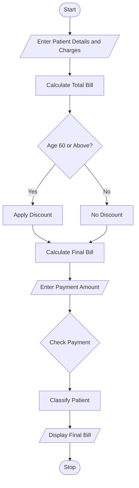

## 1. Problem Statement

Develop a Python program to calculate hospital bills based on consultation fees, diagnostic charges, and treatment charges. Apply concessions based on patient category, validate billing details, calculate the final amount, and classify patients according to their payment status.

## 2. Algorithm

1. Start the program.
2. Enter patient name and age.
3. Enter consultation, diagnostic, and treatment charges.
4. Calculate the total bill.
5. Apply a 10% concession for senior citizens aged 60 and above.
6. Calculate the final bill.
7. Enter the amount paid.
8. Check whether the payment is valid.
9. Classify the patient as:
   - Fully Paid
   - Partially Paid
   - Unpaid
10. Display the final bill and patient classification.
11. Stop.

## 3. Flowchart 

## 5. Sample Input
Enter patient name: Ravi
Enter patient age: 65
Enter consultation charges: 500
Enter diagnostic charges: 1500
Enter treatment charges: 3000
Enter amount paid: 3000
## 6. Sample Output
Patient Name: Ravi
Total Charges: Rs. 5000.0
Discount: Rs. 500.0
Final Bill: Rs. 4500.0
Amount Paid: Rs. 3000.0
Balance: Rs. 1500.0
Patient Classification: Partially Paid

The Python program successfully calculates hospital charges, applies senior citizen concessions, vpatients accostatus.

Note: The concession percentage and payment categories are assumed for educational purposes.
