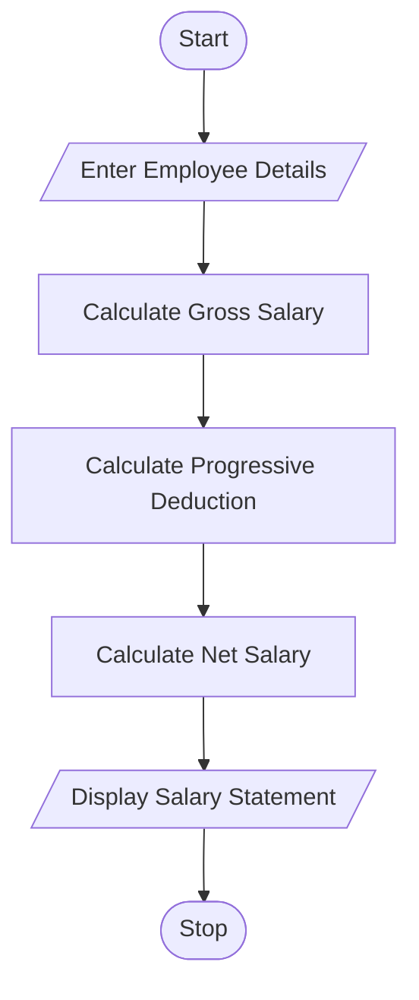

# Employee Payroll and Deduction Analysis – Python Program

## 1. Problem Statement

Write a Python program to calculate an employee's gross salary using basic pay, allowances, overtime, and incentives. Apply progressive deductions and calculate the net salary. Display a formatted salary statement.

## 2. Algorithm

1. Start the program.
2. Enter employee name and basic salary.
3. Enter allowances, overtime, and incentives.
4. Calculate gross salary.
5. Calculate progressive deductions:
   - First ₹10,000 – No deduction.
   - Next ₹10,000 – 5% deduction.
   - Above ₹20,000 – 10% deduction.
6. Calculate net salary.
7. Display the salary statement.
8. Stop the program.

## 3. Flowchart 

## 5. Sample Input
Enter employee name: Ravi
Enter basic salary: 15000
Enter allowances: 5000
Enter overtime amount: 3000
Enter incentives: 2000
## 6. Sample Output
Employee Name: Ravi
Basic Salary: Rs. 15000.0
Allowances: Rs. 5000.0
Overtime: Rs. 3000.0
Incentives: Rs. 2000.0
Gross Salary: Rs. 25000.0
Deduction: Rs. 1000.0
Net Salary: Rs. 24000.0

The Python program successfully calculates gross salary, applies progressive deductions, and displays the employee's final net salary.
